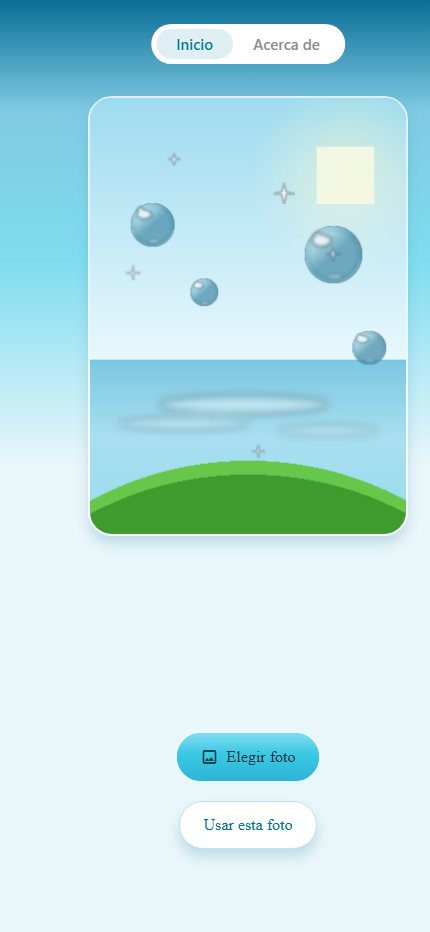
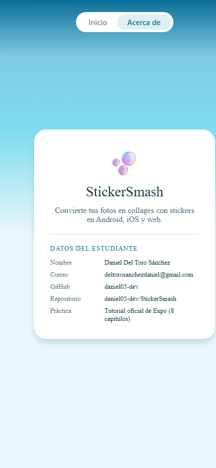

# 🫧 StickerSmash

**StickerSmash** es una app universal (Android, iOS y web) construida desde cero siguiendo el [tutorial oficial de Expo](https://docs.expo.dev/tutorial/introduction/) en sus **8 capítulos**, con una identidad visual propia: **Frutiger Aero** — cristal, agua y césped; paleta acuosa luminosa, superficies de vidrio, botones glossy y tipografía humanista redondeada (Nunito Sans).

Elige una foto (o usa la imagen por defecto), pégale stickers-orbe, arrástralos, córrelos con doble toque y guarda el resultado.

## Estudiante

| | |
|---|---|
| **Nombre** | Daniel Del Toro Sánchez |
| **Correo** | deltorosanchezdaniel@gmail.com |
| **GitHub** | [daniel05-dev](https://github.com/daniel05-dev) |
| **Repositorio** | [daniel05-dev/StickerSmash](https://github.com/daniel05-dev/StickerSmash) |

## Capturas (web, 430×932)

### Inicio



### Acerca de



## Qué hace la app

- **Dos pestañas nativas** (Inicio y Acerca de) con `NativeTabs` de Expo Router.
- **Elegir foto** con `expo-image-picker` (`allowsEditing: true` para recortar) o **usar la imagen por defecto**.
- **Selector de stickers** en una hoja inferior nativa (`BottomSheet` de `@expo/ui` con `RNHostView`): cuadrícula de 6 stickers-orbe en 3 columnas.
- **Sticker arrastrable** con gesto pan (`usePanGesture`) y **doble toque** (`useTapGesture`) para duplicar/restaurar su tamaño; ambos combinados con `useSimultaneousGestures`. El sticker nunca sale del lienzo de la imagen (320×440) gracias a `clamp()`.
- **Guardar collage**: en Android/iOS con `react-native-view-shot` + `expo-media-library`; en web se descarga como JPEG (`result: 'data-uri'`).
- **Barra de estado clara** sobre el cielo aqua, splash e icono propios con burbujas de cristal.

## Cómo ejecutar

Requisitos: Node 18+ y npm.

```bash
# 1. Instalar dependencias
npm install

# 2. Arrancar el servidor de desarrollo
npx expo start
```

Desde el terminal de Expo:

- Pulsa **w** para abrir la **web**,
- Pulsa **a** para abrir en **Android** (emulador o dispositivo),
- Pulsa **i** para abrir en **iOS** (simulador, requiere macOS), o
- Escanea el código QR con **Expo Go** en tu teléfono.

Comprobaciones usadas durante el desarrollo:

```bash
npx tsc --noEmit           # typecheck (TypeScript estricto)
npx expo export --platform web   # build de producción para web
```

## Un commit por capítulo

El historial sigue el tutorial, un capítulo por commit:

| Commit | Capítulo |
|---|---|
| `0e0bb49` | Capítulo 1: crear el proyecto — `create-expo-app`, `reset-project`, assets Frutiger Aero y fuentes Nunito Sans |
| `b6dbdaa` | Capítulo 2: navegación — Stack + NativeTabs (Inicio/Acerca de), `+not-found`, tokens del tema |
| `c7f1e93` | Capítulo 3: pantalla principal — `ImageViewer` 320×440 y botones nativos (Jetpack Compose/SwiftUI/web) |
| `a697423` | Capítulo 4: selector de imágenes — `expo-image-picker` con `allowsEditing` |
| `9b34cb0` | Capítulo 5: crear un modal — `BottomSheet` con `RNHostView`, cuadrícula de stickers, opciones |
| `5d1734a` | Capítulo 6: gestos — pan + doble toque con clamp, reanimated |
| `e1d1af7` | Capítulo 7: captura de pantalla — `captureRef` + `MediaLibrary` (data-uri en web) |
| `d172ab8` | Capítulo 8: configuración — barra de estado, splash, icono y tarjeta del estudiante |

## Estructura

```
src/
├── app/
│   ├── _layout.tsx            # Stack raíz, fuentes, GestureHandlerRootView, StatusBar
│   ├── +not-found.tsx         # Ruta inexistente
│   └── (tabs)/
│       ├── _layout.tsx        # NativeTabs: Inicio y Acerca de
│       ├── index.tsx          # Editor: foto + stickers + guardar
│       └── about.tsx          # Tarjeta de datos del estudiante
├── components/
│   ├── button.tsx|*.android.tsx|*.ios.tsx      # Botones nativos por plataforma
│   ├── circle-button.tsx|*.android.tsx|*.ios.tsx
│   ├── icon-button.tsx|*.android.tsx|*.ios.tsx
│   ├── image-viewer.tsx       # Imagen con marco de cristal
│   ├── emoji-picker.tsx       # BottomSheet (@expo/ui) con RNHostView
│   ├── emoji-list.tsx         # Cuadrícula de 6 stickers (3 columnas)
│   ├── emoji-sticker.tsx      # Sticker con gestos (pan + doble toque)
│   └── sky-gradient.tsx       # Cielo aqua de fondo
└── constants/
    └── theme.ts              # Tokens Frutiger Aero: colores, radios, espaciados
```

Todos los componentes toman sus colores, radios y espaciados de `src/constants/theme.ts`; no hay colores sueltos en `src/`.

## Tecnología

- [Expo SDK 58](https://docs.expo.dev/) · [Expo Router](https://docs.expo.dev/router/introduction/) (rutas en `src/app`) · TypeScript estricto
- [@expo/ui](https://docs.expo.dev/versions/latest/sdk/ui/) (botones nativos Jetpack Compose/SwiftUI), [expo-image](https://docs.expo.dev/versions/latest/sdk/image/), [expo-image-picker](https://docs.expo.dev/versions/latest/sdk/imagepicker/), [expo-media-library](https://docs.expo.dev/versions/latest/sdk/media-library/), [expo-status-bar](https://docs.expo.dev/versions/latest/sdk/status-bar/), [expo-linear-gradient](https://docs.expo.dev/versions/latest/sdk/linear-gradient/)
- [react-native-gesture-handler](https://docs.swmansion.com/react-native-gesture-handler/) v3 y [react-native-reanimated](https://docs.swmansion.com/react-native-reanimated/), [react-native-view-shot](https://github.com/gre/react-native-view-shot)
- Assets 100 % propios (imagen por defecto 320×440, stickers, iconos y splash), generados con Pillow a partir de emojis de OpenMoji/Segoe UI Emoji

## Retos y notas técnicas

- **Botones nativos por plataforma**: los archivos `*.android.tsx` (Jetpack Compose), `*.ios.tsx` (SwiftUI) y `*.tsx` (web) coexisten con **props idénticas**; Metro resuelve el de cada plataforma y TypeScript lee los tipos del `.tsx` base. El contenido de Expo UI solo se renderiza dentro de un `Host`, y el contenido React Native dentro de un bottom sheet nativo solo dentro de un `RNHostView`.
- **Gestos v3**: con React Compiler activo, los shared values de Reanimated se leen/escriben con `.get()`/`.set()` en lugar de `.value`. En web, `pointerEvents: 'none'` en la imagen del sticker evita que el navegador inicie su propio arrastre y cancele el pan.
- **Vista capturable**: la vista envuelta por la foto y el sticker lleva `collapsable={false}` para que `captureRef()` pueda fotografiarla en Android.
- **Advertencia de hidratación en web**: `NativeTabs` lanza un warning de hidratación en el navegador (issue conocido [expo#52249](https://github.com/expo/expo/issues/52249)); es solo un aviso en desarrollo y la navegación funciona correctamente.
- **Guardar en web**: `expo-media-library` no existe en navegador, así que la captura se descarga como JPEG vía `data-uri`.
- **Permisos**: `MediaLibrary.usePermissions({ writeOnly: true })` pide solo permiso de escritura, suficiente para guardar la captura.

## Licencia

MIT (la del template de Expo).
